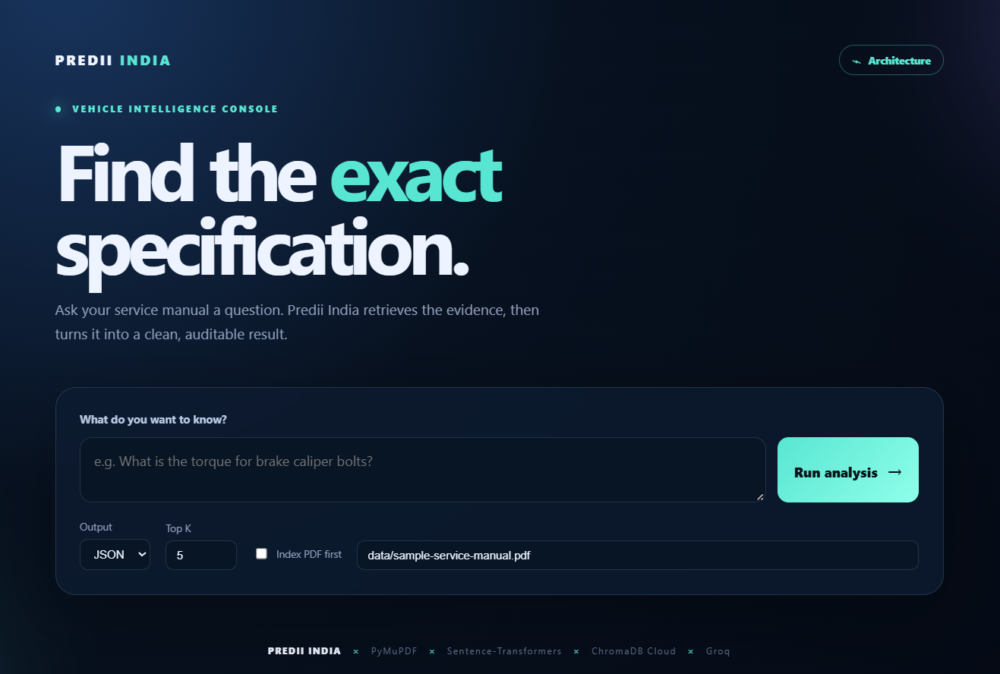

# Vehicle Specification Extraction

A Python RAG pipeline that extracts vehicle specifications from automotive
service-manual PDFs and returns grounded JSON or CSV records.

## Product flow

### 1. Architecture

<p align="center">
  
</p>

The pipeline is designed as a grounded Retrieval-Augmented Generation (RAG)
workflow:

- PDF text extraction with PyMuPDF.
- The OCR decision condition: OCR runs when extracted page text is shorter
  than 100 characters.
- OCR comparison and the PDF/OCR/combined text decision.
- Cleaning, 1000-character chunks, and 200-character overlap.
- Sentence-Transformers embedding with `all-MiniLM-L6-v2`.
- ChromaDB Cloud storage and 250-record upload batches.
- Query embedding, `top_k` semantic retrieval, Groq extraction, Pydantic
  validation, and JSON/CSV output.

### 2. User interface

<p align="center">
  
</p>

The user journey is intentionally simple:

1. Ask a question about the service manual.
2. Choose JSON or CSV output and configure retrieval settings.
3. Run the analysis.
4. Review grounded specifications with source-page evidence.
5. Download the structured result.

### Concept understanding

The project demonstrates the two core RAG stages:

1. **Retrieval**: the manual is split into chunks, embedded with
   `all-MiniLM-L6-v2`, stored in ChromaDB Cloud, and searched using the
   embedded user query.
2. **Generation**: the top retrieved chunks are passed to Groq with an
   instruction to extract only supported specifications and return structured
   JSON.

The LLM is not asked to answer from general knowledge. It is constrained to
the retrieved manual context and must include page and source-text evidence.

### Code clarity

The implementation is modular:

- PDF parsing: `src/pdf_extractor.py`
- OCR fallback: `src/ocr.py`
- Cleaning and chunking: `src/text_cleaner.py`, `src/chunker.py`
- Vector database: `src/vector_store.py`
- Retrieval: `src/retriever.py`
- LLM extraction: `src/llm_extractor.py`
- Schema validation: `src/schemas.py`
- CLI orchestration and output: `src/main.py`

Functions have focused responsibilities, explicit validation, readable names,
and documented command-line behavior in this README.

### Pipeline design

The pipeline preserves page number and extraction method metadata through every
stage:

```text
PDF pages
  -> text extraction
  -> OCR only for short/empty pages
  -> text cleaning
  -> 1000-character chunks with 200-character overlap
  -> Sentence-Transformers embeddings
  -> ChromaDB semantic retrieval
  -> Groq structured extraction
  -> Pydantic validation
  -> JSON or CSV
```

This design supports table-related queries better than sending an entire
manual to the LLM and keeps the final context bounded by `top_k`.

### Output quality

The output schema includes:

- Specification name.
- Original value and unit.
- Vehicle model and part number when available.
- Source page.
- Supporting source text.
- LLM confidence score.

The schema is validated with Pydantic before writing the result. A sample
query for brake caliper torque produces records such as:

```json
{
  "specification_name": "Brake caliper flow bolt torque",
  "value": "35",
  "unit": "Nm",
  "vehicle_model": "2014 F-150",
  "source_page": 652,
  "source_text": "Brake caliper flow bolt 35 26",
  "confidence": 1.0
}
```

The source fields make the answer auditable instead of returning an
unsupported value without evidence.

### Bonus: OCR and practical features

The project includes OCR integration through PyMuPDF, Pillow, and Tesseract.
Pages with less than 100 extracted characters are sent through OCR. The code
also compares normalized PDF and OCR text to avoid unnecessary duplication.
Additional practical features include:

- ChromaDB Cloud semantic search.
- Sentence-Transformers local embeddings.
- JSON and CSV export.
- Configurable `top_k`.
- Reusable `--no-index` query mode.
- UTF-8 output handling on Windows.
- ChromaDB upload batching.
- Pydantic validation and source citations.

## Deliverables

This repository is the implementation deliverable. It includes:

- PDF and OCR ingestion.
- Text cleaning and overlapping chunking.
- Sentence-Transformers embeddings through ChromaDB.
- ChromaDB Cloud vector storage and semantic retrieval.
- Groq LLM extraction from retrieved manual context.
- Pydantic validation of structured specification records.
- JSON and CSV output.
- A sample manual in `data/sample-service-manual.pdf`.
- A sample result in `outputs/specifications.json`.

## Design

The pipeline is deliberately split into small stages:

1. `src/pdf_extractor.py` extracts text and page numbers with PyMuPDF.
2. `src/ocr.py` runs Tesseract OCR for pages with little or no extracted text.
3. `src/text_cleaner.py` normalizes text.
4. `src/chunker.py` creates overlapping chunks while preserving page metadata.
5. `src/vector_store.py` creates a ChromaDB Cloud collection using
   `all-MiniLM-L6-v2`. Chroma computes embeddings for both documents and
   queries, so application code does not need to manage vectors.
6. `src/retriever.py` retrieves the most relevant chunks.
7. `src/llm_extractor.py` sends only retrieved context to Groq and requires
   JSON output.
8. `src/schemas.py` validates each specification and its confidence score.
9. `src/main.py` coordinates the workflow and writes JSON or CSV.

### Embeddings and ChromaDB

This project uses two different model responsibilities:

- **Sentence-Transformers** creates embeddings for semantic search. The
  configured model is `all-MiniLM-L6-v2`. It runs locally on the computer;
  it is not the final question-answering model.
- **Groq** is the LLM. It receives the retrieved manual text and converts it
  into structured specification records.

ChromaDB Cloud is the vector database. It stores each manual chunk, its page
metadata, and its embedding. When a query is made, ChromaDB embeds the query
with the same Sentence-Transformers function and returns the closest chunks.
The Groq LLM then sees only those chunks.

```text
manual chunk -> all-MiniLM-L6-v2 -> embedding -> ChromaDB Cloud
user query   -> all-MiniLM-L6-v2 -> query embedding -> nearest chunks
nearest chunks + query -> Groq -> structured JSON
```

```text
PDF
  -> PyMuPDF extraction
  -> OCR fallback
  -> cleaning and chunking
  -> Sentence-Transformers embeddings
  -> ChromaDB Cloud retrieval
  -> Groq structured extraction
  -> Pydantic validation
  -> JSON or CSV
```

## Tools

- **Python 3.12+**: application runtime.
- **PyMuPDF**: PDF text extraction.
- **pytesseract/Pillow**: OCR fallback for scanned pages.
- **ChromaDB Cloud**: hosted vector database.
- **Sentence-Transformers**: local `all-MiniLM-L6-v2` embeddings.
- **Groq**: LLM answer and specification extraction.
- **Pydantic**: output validation.
- **pytest**: test runner.

## Setup

From the repository directory:

```powershell
cd "C:\Users\abhis\OneDrive\Desktop\predii india\vehicle-spec-extractor"
python -m pip install -r requirements.txt
```

## Web UI

The project includes an animated Flask interface for querying the pipeline:

```powershell
python web_app.py
```

Open `http://127.0.0.1:5000` in a browser. Enter a question, choose JSON or
CSV, set `top_k`, and click **Run analysis**. The result is rendered in the
page and can be downloaded. The web app keeps the
initialized vector store and PDF index in memory, so only the first query for a
PDF performs the expensive indexing step. If the PDF changes, it is indexed
again automatically.

Put newly generated credentials in the constants at the top of
`src/vector_store.py` and `src/llm_extractor.py`. Never commit real keys.
Any key previously pasted into chat or source should be revoked and replaced.

For OCR support, Tesseract must also be installed and available on `PATH`.
Text-based PDFs work without OCR.

## Running

Open PowerShell and move to the project folder:

```powershell
cd "C:\Users\abhis\OneDrive\Desktop\predii india\vehicle-spec-extractor"
```

Install dependencies once:

```powershell
python -m pip install -r requirements.txt
```

Before the first run, add newly generated credentials to
`src/vector_store.py` and `src/llm_extractor.py`. The key constants must not
contain the placeholder values.

Index the sample manual and ask a question:

```powershell
python -m src.main --query "What vehicle model is covered in the manual?"
```

The first run downloads the embedding model and uploads chunks to ChromaDB.
Uploads are batched to respect the ChromaDB record limit.

### ChromaDB storage limits and partial indexing

The sample manual produces 1,372 chunks. ChromaDB Cloud applies quotas to
the tenant and collection. The code uploads chunks in batches of 250; this
batch size is only the size of one request and does **not** increase the
tenant's total storage quota.

If the ChromaDB quota allows only part of the manual to be stored, the
program may index successfully only up to the available limit. A query about
a specification in an unindexed page cannot return that specification. The
LLM will correctly report that the information is not present in the
retrieved context; this does not prove that the specification is absent from
the original PDF.

Check the indexing message and collection quota before trusting a negative
answer. For complete results, increase the ChromaDB quota or use a new
tenant/collection with enough capacity, then index the manual again. After a
complete index, use `--no-index` for subsequent questions.

For a quick test with a smaller manual or selected pages, use a reduced PDF
and query only after confirming that its chunks were uploaded. Do not treat
a partial index as a complete service-manual search.

## Important parameters

### `top_k`

`top_k` is the number of chunks returned by semantic search. The default is
`5`:

```powershell
python -m src.main --no-index --top-k 8 --query "brake caliper torque"
```

Higher `top_k` values provide more evidence and can help when a specification
is split across multiple chunks, but they also:

- Increase the amount of text sent to Groq.
- Increase cost and latency.
- Increase the chance that unrelated text distracts the LLM.

Useful starting points:

| Query type | Suggested `top_k` |
|---|---:|
| One direct value | 3-5 |
| A table or several related bolts | 5-8 |
| Broad comparison across components | 8-12 |

`top_k` cannot retrieve records that were never indexed.

### Chunk size and overlap

The current chunking defaults are in `src/chunker.py`:

| Parameter | Current value | Meaning |
|---|---:|---|
| `chunk_size` | 1000 characters | Approximate maximum text per chunk |
| `overlap` | 200 characters | Text repeated between adjacent chunks |

The overlap helps preserve a specification when it crosses a chunk boundary.
Increasing `chunk_size` preserves more surrounding table context but creates
fewer, larger records. Increasing `overlap` improves continuity but creates
more records and increases storage/upload cost.

The current CLI uses these defaults internally. If you change them, re-index
the manual because existing Chroma records were created with the old
settings.

### Embedding model

The configured model is `all-MiniLM-L6-v2`. It creates 384-dimensional
embeddings locally. The same embedding function must be used for both manual
chunks and user queries; otherwise similarity scores are not meaningful.
The model is optimized for general English semantic similarity, not
vehicle-manual terminology specifically.

### Upload batch size

`batch_size = 250` in `src/vector_store.py` controls how many records are sent
in one ChromaDB upload request. It is a request-size setting, not the total
database capacity. It was chosen to stay below the observed tenant quota.

### LLM settings

The Groq settings are in `src/llm_extractor.py`:

- `GROQ_MODEL`: the generation model.
- `temperature=0`: deterministic extraction rather than creative writing.
- Structured Pydantic schema: prevents malformed output from being saved.
- Retrieved context only: the LLM is instructed not to use outside knowledge.

The `confidence` value is the LLM's reported confidence, not a mathematically
calibrated probability. It should be reviewed together with `source_page` and
`source_text`.

## Assumptions

The pipeline currently assumes:

1. The PDF is a vehicle service manual and its text is in English.
2. Page numbers in extracted metadata correspond to the PDF's displayed pages.
3. Text extraction or OCR can read the relevant tables.
4. The question refers to the manual being indexed.
5. The relevant specification is present in the indexed Chroma collection.
6. Similar wording indicates relevant content; semantic search is not a
   guaranteed exact keyword search.
7. The top retrieved chunks contain enough context for the LLM.
8. Values and units in the manual are authoritative and should be preserved.
9. A missing result means "not found in retrieved context", not proof that
   the value does not exist in the complete manual.
10. Credentials, network access, ChromaDB quota, Groq availability, and the
    local embedding model are available at runtime.

## How to interpret a missing answer

If the output is an empty JSON array:

```json
[]
```

check these items in order:

1. Confirm `collection.count()` is greater than zero.
2. Confirm the manual was fully indexed rather than stopped by quota.
3. Increase `--top-k` for tables or multi-part questions.
4. Try a more specific query using the manual's terminology.
5. Inspect whether OCR extracted the relevant page correctly.
6. Verify that the requested page was included in the indexed collection.

Do not conclude that the manual lacks a value until these checks pass.

### Complete example

This command indexes `data/sample-service-manual.pdf`, retrieves the most
relevant sections, sends them to Groq, and writes structured results:

```powershell
python -m src.main `
  --pdf "data\sample-service-manual.pdf" `
  --query "What vehicle model is covered in the manual?" `
  --format json `
  --output "outputs\specifications.json"
```

Expected console output:

```text
Indexed 1372 chunks from 852 pages into ChromaDB.
Wrote 3 specifications to outputs\specifications.json
```

The generated `outputs\specifications.json` contains records such as:

```json
[
  {
    "specification_name": "Brake caliper flow bolt torque",
    "value": "35",
    "unit": "Nm",
    "vehicle_model": "2014 F-150",
    "part_number": null,
    "source_page": 652,
    "source_text": "Brake caliper flow bolt 35 26",
    "confidence": 1.0
  }
]
```

After the manual has been indexed, use `--no-index` for later questions.
This avoids uploading the same PDF again:

```powershell
python -m src.main `
  --no-index `
  --query "What vehicle model is covered in the manual?"
```

Use another manual:

```powershell
python -m src.main --pdf "data\my-manual.pdf" --query "What is the oil capacity?"
```

## Output

JSON is the default:

```powershell
python -m src.main `
  --no-index `
  --query "What vehicle model is covered in the manual?" `
  --format json `
  --output outputs\specifications.json
```

CSV is also supported:

```powershell
python -m src.main `
  --no-index `
  --query "What vehicle model is covered in the manual?" `
  --format csv `
  --output outputs\specifications.csv
```

Each JSON item has this shape:

```json
{
  "specification_name": "Brake caliper flow bolt torque",
  "value": "35",
  "unit": "Nm",
  "vehicle_model": "2014 F-150",
  "part_number": null,
  "source_page": 652,
  "source_text": "Brake caliper flow bolt 35 26",
  "confidence": 1.0
}
```

The `source_page` and `source_text` fields make each extracted value
auditable against the source manual.

## CLI options

```text
--pdf PATH       Input manual; defaults to data/sample-service-manual.pdf
--query TEXT     Required question
--top-k NUMBER   Retrieved chunks; defaults to 5
--no-index       Search the existing Chroma collection
--format FORMAT  json or csv; defaults to json
--output PATH    Destination; defaults to outputs/specifications.<format>
```

## Improvement ideas

- Add automated unit tests for chunk boundaries, OCR decisions, schema
  validation, and mocked Chroma/Groq calls.
- Add collection/document identifiers so multiple manuals cannot mix results.
- Add incremental hashing to avoid re-uploading unchanged chunks.
- Use a reranker after vector retrieval for more precise evidence selection.
- Add page-image citations for tables and formatting-sensitive specifications.
- Add retry, timeout, and rate-limit handling around cloud APIs.
- Store model names, query text, and retrieval distances in an audit log.
- Add an optional local LLM mode for offline or private deployments.
- Replace hardcoded credentials with a secret manager before production use.

## Limitations

- The LLM can only extract information present in the retrieved context.
- OCR quality depends on scan quality and the local Tesseract installation.
- ChromaDB Cloud quotas may limit the number or size of uploads.
- The embedding model is downloaded locally on first use.
- Cloud ChromaDB and Groq require network access and valid credentials.
